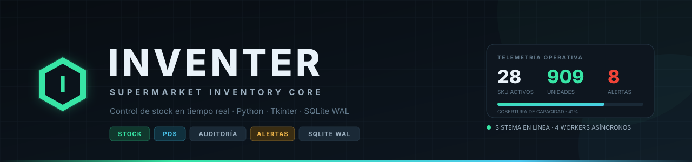
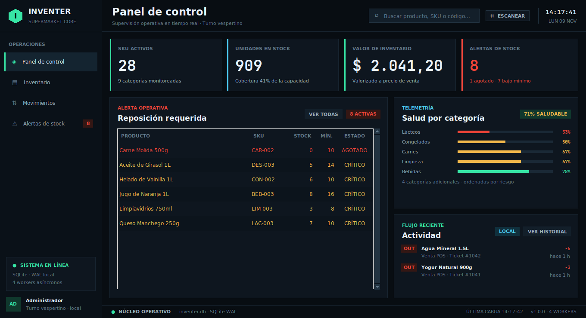
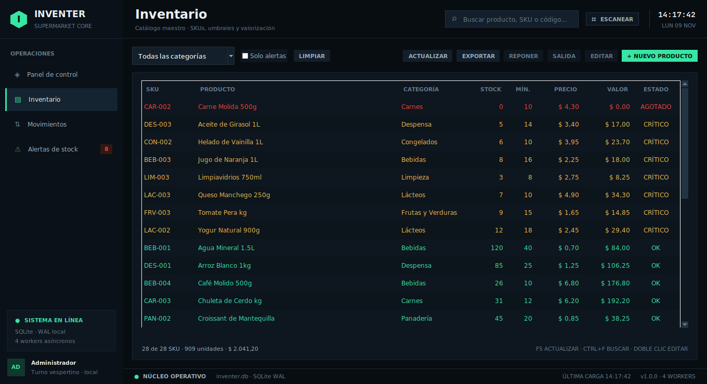
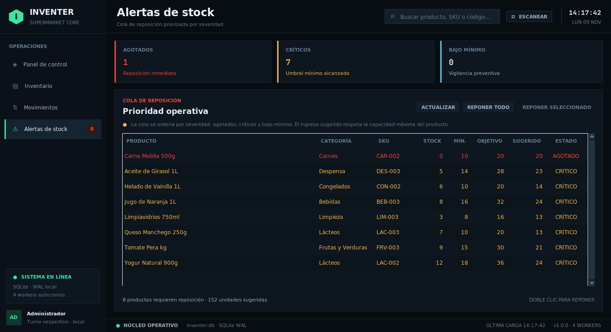
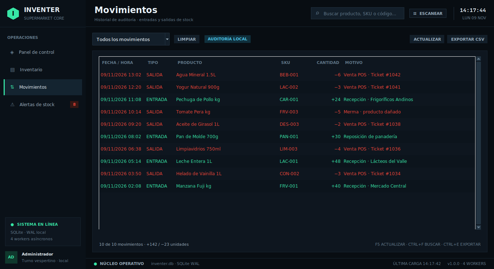
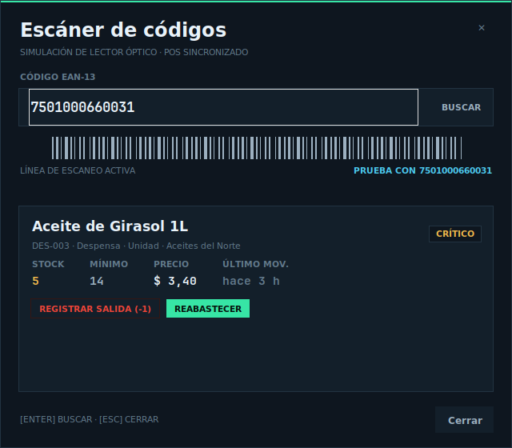
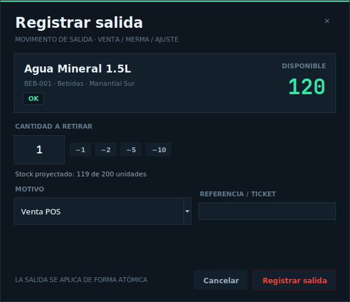

<p align="center">
  
</p>

<p align="center">
  <a href="https://github.com/grubberdubber/inventer/actions/workflows/ci.yml"></a>
  <a href="https://gitlab.com/grubberdubber/inventer/-/pipelines"></a>
  
  
  
  
  
</p>

<h1 align="center">INVENTER</h1>

<p align="center">
  <strong>Núcleo de inventario para supermercados con interfaz industrial, operaciones atómicas y telemetría de stock en tiempo real.</strong>
</p>

<p align="center">
  <a href="#-visión-general">Visión general</a> ·
  <a href="#-capturas">Capturas</a> ·
  <a href="#-arquitectura">Arquitectura</a> ·
  <a href="#-inicio-rápido">Inicio rápido</a> ·
  <a href="#-calidad">Calidad</a> ·
  <a href="#-repositorios">Repositorios</a>
</p>

---

## Visión general

**INVENTER** es una aplicación de escritorio 100 % Python para la operación diaria de un supermercado: catálogo maestro de SKU, control de umbrales, reposición priorizada, salidas de POS, auditoría de movimientos y exportación de datos. La interfaz está construida exclusivamente con **Tkinter/ttk** y sigue una estética *dark industrial* de alta densidad, sin frameworks pesados ni dependencias de terceros en tiempo de ejecución.

El sistema está diseñado para responder aunque la base de datos crezca: las consultas y mutaciones se ejecutan en un **pool de workers asíncronos**, las escrituras usan **transacciones atómicas `BEGIN IMMEDIATE`** y la UI se actualiza únicamente con *snapshots* inmutables devueltos al hilo principal de Tk.

> **Demo local con datos reales de supermercado:** 28 SKU, 9 categorías, 10 movimientos de auditoría y alertas de stock listas para operar. La base se crea y siembra automáticamente en el primer arranque.

### Capacidades principales

| Módulo | Qué resuelve |
| --- | --- |
| **Panel de control** | KPIs de SKU, unidades, valorización, alertas, salud por categoría y actividad reciente. |
| **Inventario** | Catálogo maestro con búsqueda instantánea, filtros por categoría/alertas, edición y exportación CSV. |
| **Alertas de stock** | Cola priorizada por severidad (`AGOTADO → CRÍTICO → BAJO`) con cantidad sugerida de reposición. |
| **Movimientos** | Bitácora inmutable de entradas y salidas con filtros y exportación para auditoría. |
| **Escáner** | Simulación de lector EAN-13 con búsqueda por código y acciones rápidas de venta/reposición. |
| **Reposición masiva** | Ingreso de todos los productos en alerta dentro de una sola transacción atómica. |
| **Validación** | SKU, EAN, cantidades, precios y coherencia de umbrales validados antes de tocar la base. |
| **Concurrencia** | Hasta 4 workers configurables; la UI nunca se bloquea durante consultas o escrituras. |

---

## Capturas

| Panel de control | Inventario |
| :---: | :---: |
|  |  |

| Alertas de stock | Movimientos |
| :---: | :---: |
|  |  |

| Escáner EAN-13 | Salida de stock |
| :---: | :---: |
|  |  |

---

## Arquitectura

```text
inventer/
├── core/
│   ├── database.py      # Repositorio SQLite thread-local + transacciones atómicas
│   ├── inventory.py     # Modelos inmutables, validación, umbrales y telemetría
│   └── logger.py        # Logging rotativo a var/log/inventer.log
├── ui/
│   ├── main_window.py   # Shell Tk, vistas y coordinación de workers
│   ├── widgets.py       # Widgets ttk de alto rendimiento y tema industrial
│   └── dialogs.py       # Modales de producto, reposición, salida y escáner
├── configs/
│   ├── default.json     # Parámetros operativos
│   └── theme.json       # Paleta, tipografía y layout
├── docs/
│   ├── ARCHITECTURE.md  # Decisiones de diseño y modelo de datos
│   └── screenshots/     # Evidencia visual del producto
├── tests/
│   ├── test_core.py     # Dominio, validación y persistencia atómica
│   └── test_ui.py       # Smoke test de la shell Tkinter
├── main.py              # Punto de entrada
├── pyproject.toml       # Metadatos, pytest y Ruff
└── requirements-dev.txt # Herramientas de desarrollo
```

### Flujo de datos

```text
┌──────────────────────┐   submit()   ┌──────────────────────────┐
│  Tk mainloop (UI)    │ ───────────▶ │  ThreadPoolExecutor      │
│  callbacks + after() │              │  4 workers configurables │
└──────────┬───────────┘              └────────────┬─────────────┘
           │                                       │
           │  snapshots inmutables                 │  conexión SQLite
           │  (Product / Movement / Stats)         │  thread-local
           │                                       ▼
           │                            ┌──────────────────────────┐
           └────────────────────────────│  SQLite WAL              │
                                        │  BEGIN IMMEDIATE         │
                                        │  COMMIT / ROLLBACK       │
                                        └──────────────────────────┘
```

**Principios de diseño**

- **Una sola dirección de datos:** la UI nunca muta objetos de dominio; recibe snapshots y vuelve a consultar tras cada operación.
- **Aislamiento por hilo:** cada worker obtiene su propia conexión SQLite, con `foreign_keys`, `journal_mode=WAL` y `synchronous=NORMAL`.
- **Atomicidad:** toda escritura ocurre dentro de `BEGIN IMMEDIATE`; si una validación o restricción falla, se ejecuta `ROLLBACK` completo.
- **Validación antes de persistir:** `validate_product()` normaliza y rechaza payloads inválidos; la base refuerza las reglas con `CHECK` y `UNIQUE`.
- **Errores observables:** las excepciones no controladas se registran en `var/log/inventer.log` y se notifican en la UI.

Más detalle en [`docs/ARCHITECTURE.md`](docs/ARCHITECTURE.md).

---

## Stack técnico

| Capa | Tecnología | Notas |
| --- | --- | --- |
| Lenguaje | Python **3.11+** | Type hints, `dataclass(slots=True)`, `from __future__ import annotations`. |
| Interfaz | **Tkinter + ttk** | 100 % nativo; sin PyQt, PySide ni Kivy. |
| Persistencia | **SQLite** | WAL, claves foráneas, índices y restricciones `CHECK`. |
| Concurrencia | `threading` + `concurrent.futures` | Pool de workers y polling no bloqueante con `after()`. |
| Calidad | pytest, pytest-cov, Ruff | Tests de dominio, persistencia y smoke test de UI. |
| CI/CD | GitHub Actions + GitLab CI | Matriz de Python, lint y UI smoke con Xvfb. |
| Runtime | Solo biblioteca estándar | `requirements.txt` no instala dependencias de producción. |

---

## Inicio rápido

### Requisitos

- Python **3.11 o superior**.
- Tkinter (incluido en la mayoría de instalaciones oficiales de Python).
- En Debian/Ubuntu, si falta Tkinter:

```bash
sudo apt install python3-tk
```

### Instalación

```bash
git clone https://github.com/grubberdubber/inventer.git
cd inventer

python3 -m venv .venv
source .venv/bin/activate        # Windows: .venv\Scripts\activate
python -m pip install --upgrade pip

python main.py
```

En Windows:

```powershell
py -m venv .venv
.venv\Scripts\Activate.ps1
py main.py
```

La primera ejecución crea `var/inventer.db`, aplica el esquema y siembra el catálogo demo. Para reiniciar la demo, detén la aplicación y elimina `var/inventer.db`.

### Configuración

Los parámetros operativos viven en [`configs/default.json`](configs/default.json):

| Clave | Valor por defecto | Descripción |
| --- | --- | --- |
| `database.path` | `var/inventer.db` | Ruta de la base SQLite. |
| `database.journal_mode` | `WAL` | Modo de journal para concurrencia de lectura/escritura. |
| `logging.path` | `var/log/inventer.log` | Log rotativo (1 MB × 3 backups). |
| `inventory.low_stock_factor` | `1.5` | Ancho de la banda de stock bajo. |
| `inventory.currency` | `$` | Símbolo monetario de la UI. |
| `ui.worker_threads` | `4` | Tamaño del pool de workers. |
| `ui.search_debounce_ms` | `260` | Debounce del buscador. |
| `ui.toast_ms` | `2800` | Duración de las notificaciones. |

La paleta, tipografía y layout se ajustan en [`configs/theme.json`](configs/theme.json) sin tocar código.

### Atajos de teclado

| Atajo | Acción |
| --- | --- |
| `F5` | Sincronizar datos. |
| `Ctrl + N` | Nuevo producto. |
| `Ctrl + F` | Enfocar búsqueda global. |
| `Ctrl + E` | Exportar la vista actual a CSV. |
| `Doble clic` | Editar producto / reponer alerta. |
| `Esc` | Cerrar el modal activo. |

---

## Calidad

### Tests

```bash
python -m pip install -r requirements-dev.txt

python -m pytest -q
python -m pytest --cov=core --cov=ui --cov-report=term-missing
```

La suite cubre:

- Validación y normalización de productos (SKU, EAN, importes, umbrales).
- Clasificación de stock, orden por severidad y cálculo de reposición.
- Agregación de telemetría y salud por categoría.
- Persistencia: seed, unicidad, ajustes atómicos, reposición masiva y rollback.
- Smoke test de la shell Tkinter (se omite automáticamente sin display).

### Lint

```bash
ruff check .
```

### Integración continua

| Plataforma | Pipeline | Cobertura |
| --- | --- | --- |
| GitHub Actions | [`.github/workflows/ci.yml`](.github/workflows/ci.yml) | Ruff + pytest en Python 3.11, 3.12 y 3.13 + UI smoke con Xvfb. |
| GitLab CI | [`.gitlab-ci.yml`](.gitlab-ci.yml) | Ruff + pytest + UI smoke con Xvfb en Debian. |

---

## Modelo de datos

```sql
products (
  id, sku UNIQUE, barcode UNIQUE, name, category, unit,
  stock >= 0, min_stock >= 1, max_stock >= 1,
  price >= 0, cost >= 0, supplier, updated_at
)

movements (
  id, product_id → products(id) ON DELETE CASCADE,
  kind IN ('IN', 'OUT'), quantity > 0, note, created_at
)
```

- `products.stock` se actualiza siempre junto con un registro en `movements`.
- `movements` es la fuente de verdad para auditoría y trazabilidad.
- Los índices cubren categoría, umbrales de stock y fecha de movimiento.

---

## Roadmap

- [x] CRUD de catálogo con validación estricta.
- [x] Alertas por umbral y reposición masiva atómica.
- [x] Auditoría de entradas/salidas y exportación CSV.
- [x] Escáner EAN-13 simulado y salidas rápidas.
- [x] UI asíncrona con workers y tema industrial.
- [x] CI dual (GitHub + GitLab) y suite de tests.
- [ ] Autenticación por roles y operadores.
- [ ] Sincronización multi-sucursal.
- [ ] Adaptador PostgreSQL para despliegues centralizados.
- [ ] API REST para integración con POS externos.

Las propuestas son bienvenidas: abre un *issue* con la plantilla correspondiente.

---

## Repositorios

| Plataforma | URL |
| --- | --- |
| GitHub | [github.com/grubberdubber/inventer](https://github.com/grubberdubber/inventer) |
| GitLab | [gitlab.com/grubberdubber/inventer](https://gitlab.com/grubberdubber/inventer) |

---

## Contribuir

Lee [`CONTRIBUTING.md`](CONTRIBUTING.md) antes de abrir un *pull request*. Se aplican:

- Commits convencionales (`feat:`, `fix:`, `refactor:`, `sec:`, `docs:`).
- Tests para toda lógica de dominio o persistencia.
- Capturas actualizadas para cambios visibles de UI.
- `ruff check .` y `pytest -q` en verde.

Este proyecto sigue el [`CODE_OF_CONDUCT.md`](CODE_OF_CONDUCT.md). Para reportar vulnerabilidades, usa [`SECURITY.md`](SECURITY.md) y evita abrir un issue público.

---

## Licencia

Distribuido bajo la licencia **MIT**. Consulta [`LICENSE`](LICENSE).

<p align="center">
  <sub>INVENTER · Supermarket Inventory Core · construido con Python, Tkinter y SQLite.</sub>
</p>
